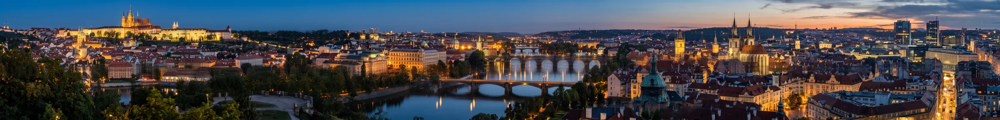
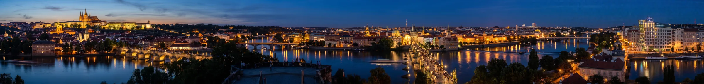
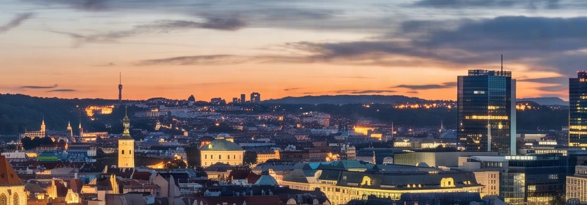
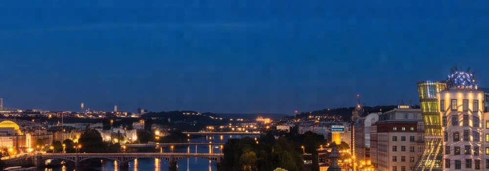
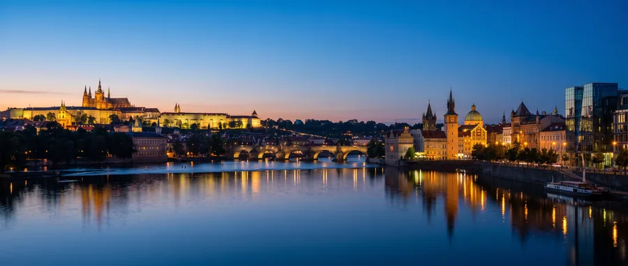

# Benchmark: Nano Banana 2.1 vs Pro vs Nano Banana 2 (2026-10-11)

Same prompt, same settings (2K, PNG, standard API tier), one run per cell — this is a
sanity check of Google's claims for 2.1, not a statistical study. Cost is the real bill
computed from `usage_metadata`; time is wall-clock per call. Script: CLI 1.1.0
`ImageGenerator`, with the deprecated Nano Banana 2 (`gemini-3.1-flash-image`) added
ad-hoc for the comparison. Total spend: **$0.69**.

Google's claims for 2.1 (changelog 2026-10-06): better visual quality, prompt adherence,
multi-turn character consistency, text rendering, and **wide/panoramic ratios
(`1:4`, `4:1`, `1:8`, `8:1`) without the tiling artifacts** of Nano Banana 2.
We tested the two that are visible in a single image: panorama and text.

## Results

| Scenario | Model | Ratio | Real cost | List price | Time |
|---|---|---|---|---|---|
| A — panorama | **2.1** | 8:1 | **$0.060** | $0.050 | 20 s |
| A — panorama | Nano Banana 2 | 8:1 | $0.102 | $0.101 | 15 s |
| A — panorama | Pro | 21:9 *(8:1 unsupported)* | $0.139 | $0.134 | 21 s |
| B — Czech text | **2.1** (`medium`) | 3:4 | **$0.068** | $0.050 | 23 s |
| B — Czech text | 2.1 (`-t high`) | 3:4 | $0.079 | $0.050 | 45 s |
| B — Czech text | Pro | 3:4 | $0.145 | $0.134 | 26 s |
| B — Czech text | Nano Banana 2 | 3:4 | $0.102 | $0.101 | 14 s |

## A — Panoramic 8:1 web header (where 2.1 should win most)

Prompt: one continuous blue-hour photograph of the Prague skyline from Letná,
Prague Castle on the far left to modern glass towers on the far right.

- **2.1** — clean, continuous 5856×704 image, castle → bridges → old town → towers
  exactly as asked, smooth sky gradient.
- **Nano Banana 2** — the composition is good, but the sky in the right third shows
  **clearly visible blocky tiling** (square patches in the dark blue) — exactly the
  artifact Google says 2.1 fixes.
- **Pro** — beautiful and coherent, but it can't produce 8:1 at all; 21:9 is its widest.
  For an 8:1 header you'd crop away ~60 % of the height.

Sky detail at native pixels, right edge — 2.1 vs Nano Banana 2:

**Verdict: clear win for 2.1** — the only model that does a clean native 8:1, at 43 % of Pro's price.

## B — Czech text-heavy poster

Prompt: title "Jak psát prompty na obrázky" + five numbered Czech rules full of
ř / ě / ň / š / ž + footer "AI First · aifirst.cz".

- **All four outputs: zero spelling or diacritics errors.** Every word, the em-dash and the
  footer came out right on 2.1, 2.1-high, Pro and Nano Banana 2.
- Casing: 2.1 and Pro turned the sentence-case title into ALL CAPS; NB2 kept it as written.
- `-t high` didn't help: 2× slower, +15 % cost, and the layout was worse (large empty gap).
- Pro's icons are the most illustrative; 2.1's are fine. Differences are taste, not quality.

| 2.1 | 2.1 high | Pro | NB2 |
|---|---|---|---|
|  |  |  |  |

**Verdict: tie on quality** — text rendering is solved at this density on every current
model. The difference is price: 2.1 at $0.068 vs Pro at $0.145.

## Takeaways (applied in CLI 1.1.0 and the skill)

1. **2.1 is the default.** Same text quality as Pro, ~2.1–2.3× cheaper in real cost.
2. **Banners/headers: use native `8:1` / `4:1` on 2.1** instead of cropping 21:9.
3. **Budget with real cost, not list price** — thinking tokens add 20–36 % on 2.1 at 2K.
4. **Leave thinking at `medium`.** `high` doubled latency without a better result here.
5. Not tested (needs multi-turn or multi-reference flows the CLI doesn't do): multi-turn
   character consistency, search grounding, multi-reference fidelity.
